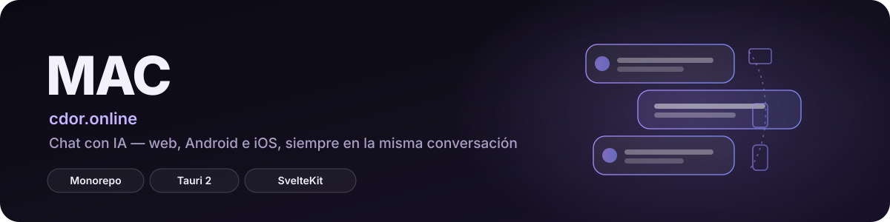

<p align="center">
  
</p>

<p align="center">
  <a href="https://cdor.online"></a>
  
  
</p>

---

CDOR es una plataforma de chat con inteligencia artificial compuesta por una aplicación web
(**[cdor.online](https://cdor.online)**), aplicaciones Android e iOS, y una API central que
sincroniza cuenta, conversaciones, mensajes, memorias y preferencias entre dispositivos. NVIDIA
NIM actúa como proveedor de inferencia, siempre detrás de la API propia — el modelo nunca se llama
directamente desde el cliente.

La arquitectura, los límites técnicos y el orden de desarrollo están definidos en
[`CDOR_PLAN_DEFINITIVO.md`](./CDOR_PLAN_DEFINITIVO.md), la fuente canónica del proyecto.

## Qué comparten la web y el móvil

La web y la app móvil no tienen por qué verse idénticas, pero comparten:

- La misma cuenta y las mismas conversaciones, mensajes, memorias y preferencias sincronizables.
- El mismo protocolo de API, los mismos identificadores y formatos de datos.
- Las mismas reglas de seguridad y límites de uso.

## Arquitectura

Monorepo gestionado con **pnpm workspaces**:

| Directorio | Descripción |
| --- | --- |
| `apps/platform` | Aplicación **SvelteKit 3** (Svelte 5, TypeScript, Drizzle ORM sobre MySQL, Better Auth 1.7). Sirve la web y la API. Desplegada en Hostinger Business. |
| `apps/mobile` | Aplicación **Svelte 5 + Tauri 2 (Rust)** para Android e iOS. |
| `packages/contracts` | Contratos compartidos en **Zod** — fuente de verdad de los tipos que consumen `platform` y `mobile`. |

Detalles adicionales de arquitectura, capas del backend, protocolo de API, IA/streaming y
sincronización están documentados en [`docs/`](./docs) y en
[`CDOR_PLAN_DEFINITIVO.md`](./CDOR_PLAN_DEFINITIVO.md).

## Seguridad

Este repo se publica tras una auditoría explícita de secretos (histórico de commits limitado a una
instantánea revisada, sin `.env`/`.pem`/`.key`/`.p12`/keystores reales, sin cadenas con forma de
token). Además, el propio proyecto vigila esto en CI: [`scripts/scan-client-secrets.mjs`](./scripts/scan-client-secrets.mjs)
verifica que ningún valor de entorno del servidor se cuele en el bundle del cliente.

## Toolchain

- Node.js 24.18.0
- pnpm 11.3.0
- Rust estable
- JDK 17 para Android
- Android NDK side-by-side

El archivo `.node-version` y `package.json#engines` fijan Node 24. **No se debe construir con
Node 26 aunque esté instalado globalmente.**

## Primeros pasos

```bash
source scripts/env.sh
./scripts/check-toolchain.sh
pnpm install --frozen-lockfile
pnpm check
pnpm build:platform
pnpm build:mobile
cargo check --manifest-path apps/mobile/src-tauri/Cargo.toml
```

`scripts/env.sh` activa el toolchain de CDOR solo en el shell actual; no cambia los runtimes
globales usados por otros proyectos.

Las variables de entorno necesarias (credenciales de base de datos, proveedor de IA, SMTP, OAuth,
etc.) están listadas por nombre en [`.env.example`](./.env.example) — todas en blanco. Nunca se
suben valores reales ni el archivo `.env`.

## Despliegue en Hostinger

Hostinger clona el monorepo completo, pero instala y compila solo la plataforma:

```bash
pnpm install --frozen-lockfile --filter @cdor/platform...
pnpm hostinger:build
pnpm hostinger:start
```

El build de Hostinger no ejecuta Tauri, Cargo, Gradle ni Xcode.

## Documentación adicional

- [`CDOR_PLAN_DEFINITIVO.md`](./CDOR_PLAN_DEFINITIVO.md) — documento rector de arquitectura,
  límites y orden de desarrollo.
- [`docs/`](./docs) — referencia de API, autenticación, modelo de datos, capa de IA y puente Tauri.
- [`docs/ui.md`](./docs/ui.md) — sistema de diseño de la web: tokens, tema, componentes y patrones.
